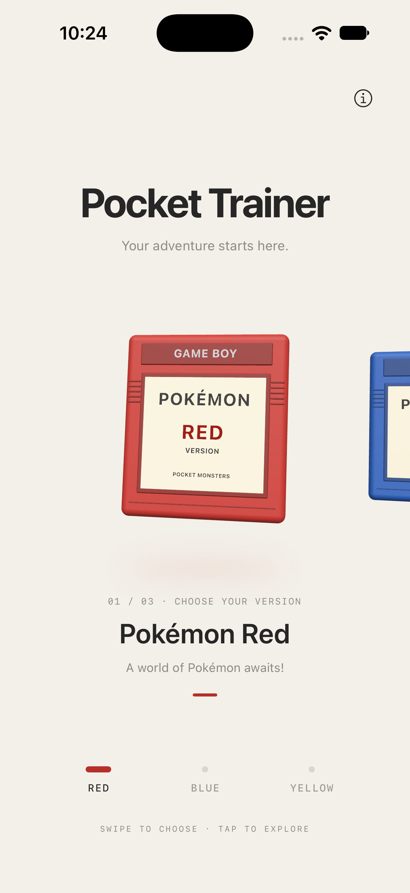
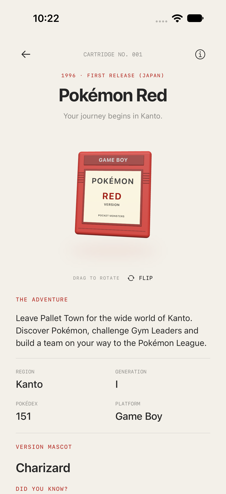
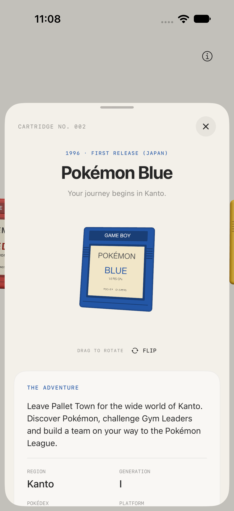
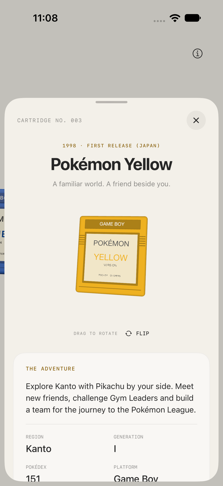

<div align="center">

# Pocket Trainer

**YOUR ADVENTURE STARTS HERE.**

🔴 **RED** &nbsp; · &nbsp; 🔵 **BLUE** &nbsp; · &nbsp; 🟡 **YELLOW**

A little nostalgia, a little SwiftUI, and three cartridges worth picking up again.




**SWIPE TO CHOOSE · TAP TO EXPLORE**

</div>

## ▸ Choose your version

Pocket Trainer is a native iOS interaction experiment by **Tajdid Rahman**, part of **Wee Interactions**. Swipe through Pokémon Red, Blue and Yellow, then tap a cartridge to take a closer look.

The collection follows your finger, settles into place with a damped spring, and gives a subtle selection haptic. Each cartridge has its own color and a small invitation to adventure.

| GAME | VERSION | YOUR ADVENTURE |
| :--- | :--- | :--- |
| `001` | 🔴 Pokémon Red | A world of Pokémon awaits! |
| `002` | 🔵 Pokémon Blue | A whole new world to explore! |
| `003` | 🟡 Pokémon Yellow | Your very own Pokémon story! |

## ▸ Take a closer look

Tap the selected cartridge. It moves into focus, the neighboring versions fade, and a compact game detail screen unfolds around it. The **same RealityKit scene stays alive** through the transition.

- **Drag to rotate.** Inspect the cartridge in 3D.
- **FLIP.** Turn it over to see the back.
- **Explore the story.** Read a short introduction, a few game facts, its mascot name and a little trivia.
- **Back to collection.** Return using the arrow, the bottom button, or a downward swipe on the heading. Your selection stays where you left it.

<div align="center">



</div>

This is a cartridge browsing and inspection prototype. It does not run game ROMs.

## ▸ Start your journey

**You’ll need:** Xcode with an iOS 18 or newer SDK, and an iPhone or iPad simulator. No packages, accounts or network access are needed to run the app.

```sh
git clone https://github.com/tajdid/pocket-trainer.git
cd pocket-trainer
open Pocket.xcodeproj
```

Choose the **Pocket** scheme and an iOS simulator, then press **Run**. The installed app is named **Pocket Trainer**. For a physical device, configure your own signing team first.

The app opens straight into the collection. There is no onboarding gate or first-run dialogue.

## ▸ Under the shell

| PART | BUILT WITH |
| :--- | :--- |
| Interface | SwiftUI · system sans-serif · monospace details |
| Cartridges | RealityKit · non-AR `ARView` · procedural 3D geometry |
| Movement | Finger-following carousel · end resistance · spring settling |
| Feedback | Native selection and soft impact haptics |
| Accessibility | Adjustable cartridge control · explore/flip actions · Reduce Motion support |
| Lifecycle | Pauses scene updates while inactive or while Trainer’s guide is open |

Pocket Trainer started from **Rewind**, an earlier Wee Interactions cassette experiment. It reuses the non-AR scene/coordinator architecture, entity track, bounded spring integration, drag tilt, swipe thresholds and lifecycle cleanup. Rewind remains untouched; this project has its own bundle identifier, `studio.weeinteractions.Pocket`.

```text
Pocket/
  PocketApp.swift        Collection, game details and Trainer’s guide
  Cartridge.swift        Version themes, descriptions and game facts
  CartridgeScene.swift   Shared 3D scene, movement and model loading
PocketUITests/           Browse → inspect → return checks
Pocket.xcodeproj/         Open this to play with the prototype
```

## ▸ A note from the asset lab

The bundled cartridges are **original procedural placeholders** with typographic labels and simple backs. No Sketchfab models, Pokémon character illustrations, ROMs or game audio are included. The app icon is AI-generated artwork inspired by a retro cartridge. Mascots are named in text.

Have models you’re permitted to use? The scene can load `CartridgeRed.usdz`, `CartridgeBlue.usdz` and `CartridgeYellow.usdz` from the app bundle. Missing or invalid imports retain their placeholders. Follow [the asset import guide](ASSET-IMPORT.md), including adding the files to the app target’s resources and updating credits.

Pokémon and Game Boy names belong to their respective owners. Pocket Trainer is an unofficial personal interaction study, with no affiliation to Nintendo, Creatures or GAME FREAK. This repository does not grant rights to third-party names, artwork or models.

## ▸ Save point

Simulator build and UI tests have passed on **iPhone 18 Pro / iOS 27.0**. Tests cover all three detail screens, flipping and drag inspection without changing versions, returning to the same selection, and carousel boundaries. Screenshots were visually reviewed.

Physical-device haptic feel, long-session performance, other screen sizes and real VoiceOver navigation still need assessment. See [verification notes](VERIFICATION.md) for the precise scope and [game sources](GAME-SOURCES.md) for the detail copy’s factual references.

To run the UI checks, use **Product → Test** in Xcode with the Pocket scheme and a simulator selected.

---

<div align="center">

**THREE VERSIONS. ONE FAMILIAR FEELING.**

Made by Tajdid Rahman · Wee Interactions

</div>
